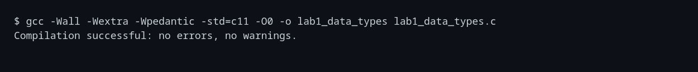
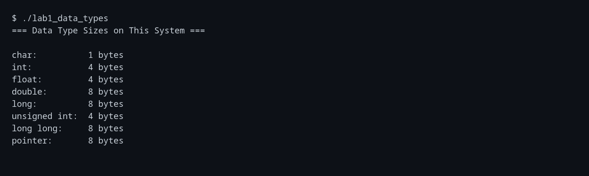
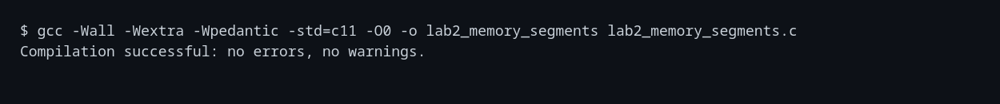
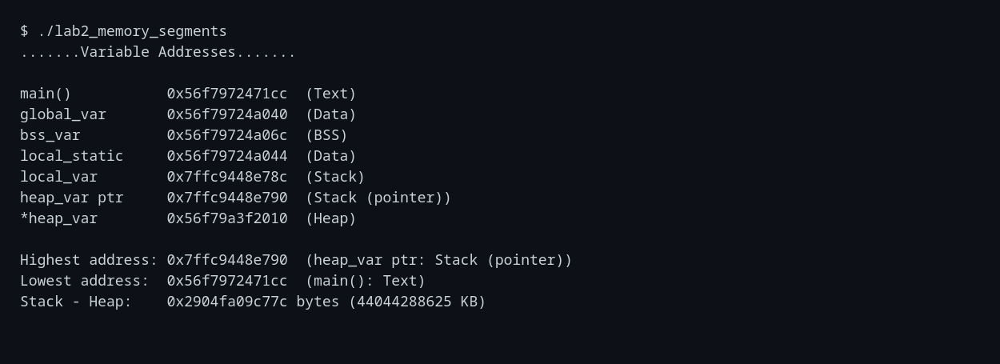

# OS Lab 3 — Data Types and OS Memory Management

Practical exercises from `OS_3_Lab.pdf`: observing C data type sizes and mapping variables to process memory segments.

Environment: Linux x86_64 (64-bit), GCC 16.2.1. Compiled with:

```sh
gcc -Wall -Wextra -Wpedantic -std=c11 -O0 -o lab1_data_types lab1_data_types.c
gcc -Wall -Wextra -Wpedantic -std=c11 -O0 -o lab2_memory_segments lab2_memory_segments.c
```

> Addresses shown below are from one sample run. ASLR randomizes them on every execution; the relative ordering of the segments stays the same.

## Lab 1 — Data Type Size Exploration

Source: [`lab1_data_types.c`](lab1_data_types.c)

Compilation (no errors, no warnings): 

Output: 

| Data type | Observed (64-bit) | Table I 64-bit | Match |
|---|---|---|---|
| `char` | 1 byte | 1 byte | yes |
| `int` | 4 bytes | 4 bytes | yes |
| `float` | 4 bytes | 4 bytes | yes |
| `double` | 8 bytes | 8 bytes | yes |
| `long` | 8 bytes | 8 bytes | yes |
| `unsigned int` | 4 bytes | 4 bytes | yes |
| `long long` | 8 bytes | 8 bytes | yes |
| `pointer` | 8 bytes | 8 bytes | yes |

**Why can `sizeof(long)` differ between 32-bit and 64-bit systems?** The C standard only sets a minimum size for `long`; the ABI decides its width. On 32-bit systems the data model is typically ILP32 (int/long/pointer = 4 bytes), while 64-bit Unix systems use LP64, where `long` and pointers are 8 bytes. (Windows 64-bit uses LLP64, where `long` stays 4 bytes.)

## Lab 2 — Memory Segment Address Mapping

Source: [`lab2_memory_segments.c`](lab2_memory_segments.c)

Compilation (no errors, no warnings): 

Output: 

| Variable | Segment | Sample address | Why |
|---|---|---|---|
| `main()` | Text | `0x56f7972471cc` | Executable instructions, fixed size |
| `global_var` | Data | `0x56f79724a040` | Global, explicitly initialized |
| `bss_var` | BSS | `0x56f79724a06c` | Global, zero-initialized |
| `local_static` | Data | `0x56f79724a044` | Static lifetime, initialized |
| `local_var` | Stack | `0x7ffc9448e78c` | Local automatic variable |
| `heap_var` | Stack | `0x7ffc9448e790` | Pointer itself is a local variable |
| `*heap_var` | Heap | `0x56f79a3f2010` | Memory from `malloc()` |

- **Highest addresses:** Stack (`local_var` / `heap_var`), around `0x7ffc...`.
- **Lowest addresses:** Text and Data/BSS, around `0x56f7...` (a PIE load base randomized by ASLR).
- **Stack − heap difference in the sample run:** `0x2904fa09c77c` bytes (~44,044,288,625 KB); the exact value changes each run.

**Observation:** The relative layout matches the process memory model: code and Data/BSS occupy low addresses, the heap grows upward from just above them, and the stack sits at the very top and grows downward. The `heap_var` pointer lives on the stack but points into the heap, showing how the two segments are connected: stack allocation is automatic, while heap memory must be allocated with `malloc()` and released with `free()`.

## Files

- `lab1_data_types.c`, `lab2_memory_segments.c` — source code
- `lab1_output.txt`, `lab2_output.txt` — raw program output
- `screenshots/` — compilation and output screenshots (PNG) plus their text originals
- `README.md` — answers and observations
